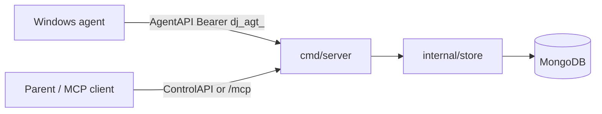

# Dad Joke

Open-source parental control and native policy enforcement for **Windows Home** — a hardened LocalSystem agent plus a self-hosted control plane you can drive from an API or a remote MCP client.

[](https://github.com/barzoj/dad-joke/actions/workflows/ci.yml)
[](https://github.com/barzoj/dad-joke/actions/workflows/security.yml)
[](https://github.com/barzoj/dad-joke/actions/workflows/ci.yml)
[](https://github.com/barzoj/dad-joke/releases/latest)
[](LICENSE)

## Table of contents

- [What & why](#what--why)
- [Features](#features)
- [Architecture at a glance](#architecture-at-a-glance)
- [Quick start](#quick-start)
- [Install the server (self-host)](#install-the-server-self-host)
- [Connect an MCP client](#connect-an-mcp-client)
- [Install the Windows agent](#install-the-windows-agent)
- [Troubleshooting](#troubleshooting)
- [Security notes](#security-notes)
- [Development](#development)
- [License](#license)

## What & why

Windows Home families need real parental controls without buying Enterprise tooling or sending traffic to a vendor cloud. Dad Joke is built for that:

- The **child session** is a Standard User.
- The **agent** is a Windows Service under `LocalSystem`, with binaries and config locked to `SYSTEM` + `Administrators`.
- A **self-hosted control plane** (AgentAPI + ControlAPI + remote MCP) lets a parent — or an assistant talking MCP — manage machines, policies, jobs, and tokens.
- Everything is **open source** and **self-hosted**. There is no Dad Joke SaaS; you run the server.

Design and threat-model details live in [`docs/ARCHITECTURE.md`](docs/ARCHITECTURE.md), [`docs/SECURITY_MODEL.md`](docs/SECURITY_MODEL.md), and [`SECURITY.md`](SECURITY.md).

## Features

Only what exists on `main` today:

- **Windows service agent** — delayed auto-start under `LocalSystem`, SCM failure recovery (restart), outbound firewall allow rule for the agent binary, strict `SYSTEM` + `Administrators` ACLs on install and data directories.
- **Heartbeat & machine inventory** — agent posts `POST /v1/heartbeat` (includes `time_zone` / `utc_offset_minutes`); ControlAPI lists machines with computed `online` / `offline` status.
- **Versioned low-level policies** — opaque JSON desired state per machine with monotonic versions (`expected_version` optimistic concurrency); agents fetch applied/desired versions via AgentAPI.
- **One-shot jobs** — enqueue `powershell` or `cmd` scripts; agent claims under a Job Object with hard timeouts, 64 KiB I/O caps, and local JSONL audit.
- **Events** — agent telemetry ingest with idempotent `event_id`s and a 30-day MongoDB TTL.
- **Facts & usage** — Windows agent samples interactive sessions (`session.state`) and per-user processes (`proc.sample`) on `sample_interval_seconds` (default 60), queues batches under `ProgramData\DadJoke\facts\` (20 MiB cap, `SYSTEM`+`Administrators` ACL), and uploads to AgentAPI `POST /v1/facts` with durable retry. Ingest is append-only and idempotent on `(stream_id, seq)` (retention via `DAD_JOKE_FACTS_RETENTION_DAYS`, default 30 days). ControlAPI `GET /v1/machines/{machine_id}/usage?date=` returns per-app `seconds` / `fg_seconds` for one machine-local calendar day.
- **Self-update** — SHA-256–verified updates from GitHub Releases (poll interval default 60s); automatic service restart after apply.
- **Multi-tenant backend** — local email/password auth, revocable sessions (`dj_ses_…`), agent tokens (`dj_agt_…`), API keys (`dj_pat_…`).
- **Remote MCP** — Streamable HTTP at `/mcp` with eight tools: `list_machines`, `get_machine`, `set_policy`, `run_script`, `get_job`, `list_events`, `get_usage`, `manage_agent_tokens`.

## Architecture at a glance

Two HTTP surfaces share one process and one MongoDB-backed DAL: agents speak **AgentAPI** with `dj_agt_…` bearer tokens; parents and MCP clients speak **ControlAPI** / **MCP** with `dj_pat_…` or session credentials. The Windows agent never applies product logic itself beyond reconciling desired state and running claimed jobs.



Full design: [`docs/ARCHITECTURE.md`](docs/ARCHITECTURE.md). Threat model: [`docs/SECURITY_MODEL.md`](docs/SECURITY_MODEL.md). Reporting: [`SECURITY.md`](SECURITY.md).

## Quick start

Five minutes on a machine with Docker Compose v2:

```bash
docker compose up --build
curl -fsS http://127.0.0.1:8080/healthz
# {"status":"ok"}
```

Register a user (dev compose sets `ALLOW_SIGNUP=true`):

```bash
curl -fsS -X POST http://127.0.0.1:8080/v1/auth/register \
  -H 'Content-Type: application/json' \
  -d '{"email":"you@example.com","password":"choose-a-strong-password","tenant_name":"home"}'
```

Or run the full smoke path the CI job uses (register → PAT → agent token → heartbeat → MCP):

```bash
BASE_URL=http://127.0.0.1:8080 ./scripts/smoke-e2e.sh
```

Dev compose publishes MongoDB `27017` and server `8080`. The server runs non-root with a read-only root filesystem.

## Install the server (self-host)

### Prerequisites

- Docker Engine + Compose v2
- A DNS name pointing at the host (for automatic HTTPS)
- Host ports **80** and **443** free

### Deploy with the public image

Public templates live under [`deploy/`](deploy/):

| File | Role |
| --- | --- |
| [`deploy/compose.prod.yml`](deploy/compose.prod.yml) | MongoDB + `ghcr.io/barzoj/dad-joke-server` + Caddy. Does **not** publish `27017` or `8080`. |
| [`deploy/Caddyfile`](deploy/Caddyfile) | TLS template; reverse-proxies to `server:8080`. |
| [`deploy/caddy-entrypoint.sh`](deploy/caddy-entrypoint.sh) | Renders one Caddy site block from `API_DOMAIN` / `MCP_DOMAIN`. |
| [`deploy/env.example`](deploy/env.example) | Copy to `deploy/.env` and edit. |

```bash
cp deploy/env.example deploy/.env
# Edit API_DOMAIN and MCP_DOMAIN (may be identical). Prefer ALLOW_SIGNUP=false.
docker compose -f deploy/compose.prod.yml --env-file deploy/.env up -d
```

`API_DOMAIN` is the ControlAPI / AgentAPI hostname; `MCP_DOMAIN` is the MCP hostname (`/mcp`). When both are the same value, the entrypoint emits a single-host site address. When they differ, it emits `{$API_DOMAIN}, {$MCP_DOMAIN}` in one block (Caddy rejects duplicate site addresses).

### Environment variables

Compose / `.env` values and server process env (defaults from `cmd/server` and `deploy/`):

<!-- docs-check:env-vars -->

| Variable | Default | Where | Purpose |
| --- | --- | --- | --- |
| `API_DOMAIN` | (required in prod `.env`) | `deploy/env.example`, Caddy | Public hostname for ControlAPI / AgentAPI |
| `MCP_DOMAIN` | (required in prod `.env`) | `deploy/env.example`, Caddy | Public hostname for `/mcp` (may equal `API_DOMAIN`) |
| `IMAGE_TAG` | `latest` | `deploy/env.example`, prod compose | `ghcr.io/barzoj/dad-joke-server` tag |
| `DAD_JOKE_MONGODB_URI` | `mongodb://127.0.0.1:27017` | server / compose | MongoDB connection URI (compose sets `mongodb://mongo:27017`) |
| `DAD_JOKE_MONGODB_DATABASE` | `dadjoke` | server / compose / `.env` | Database name |
| `DAD_JOKE_FACTS_RETENTION_DAYS` | `30` | server / compose / `.env` | Facts TTL and max fact age on ingest (valid `1..365`; invalid → process exits before listen) |
| `DAD_JOKE_HTTP_ADDR` | `:8080` | server / compose | HTTP listen address (stay internal behind the proxy) |
| `ALLOW_SIGNUP` | `true` in process default; prod compose / `.env` prefer `false` | server / compose / `.env` | When `false`, `POST /v1/auth/register` returns `403` |
| `COOKIE_SECURE` | `true` | server / compose | Session cookie `Secure` flag (`false` only for local HTTP) |
| `DAD_JOKE_CREATE_USER_PASSWORD` | (empty) | server (`create-user`) | Password for `server create-user` when `--password` is omitted |

<!-- /docs-check:env-vars -->

### TLS reverse proxy

Production compose bundles **Caddy** for automatic HTTPS on 80/443. Any reverse proxy works if it:

- Terminates TLS for your API / MCP hostnames
- Forwards to `server:8080` on the internal Docker network
- Does **not** publish MongoDB (`27017`) or the app port (`8080`) to the internet

### First credentials (`ALLOW_SIGNUP=false`)

`create-user` and `bootstrap` each create a **new** tenant. Use **one** path, not both — running both leaves an orphan tenant/PAT.

#### Path A (recommended): `create-user` → login → tokens

Creates a tenant + email/password user (works even when HTTP signup is disabled):

```bash
docker compose -f deploy/compose.prod.yml --env-file deploy/.env \
  exec server /server create-user --email you@example.com --password 'choose-a-strong-password'
# optional: --tenant-name home  (default tenant name = email)
```

Log in (`POST /v1/auth/login`; body fields `email`, `password` from TypeSpec `LoginRequest`):

```bash
curl -fsS -X POST https://api.your-server.example/v1/auth/login \
  -H 'Content-Type: application/json' \
  -d '{"email":"you@example.com","password":"choose-a-strong-password"}'
```

`200` JSON (`AuthSession`): `access_token` (`dj_ses_…`), `token_type` (`"Bearer"`), `expires_at`, and `user` (`id`, `email`, `tenant_id`). The same session is also set as an `HttpOnly` cookie `dj_session`. Use the bearer session for the next calls:

```bash
SESSION='dj_ses_<64 hex>'   # from access_token above

# Optional but recommended for MCP / automation: issue a PAT (CreateApiKeyRequest: name)
curl -fsS -X POST https://api.your-server.example/v1/api-keys \
  -H "Authorization: Bearer ${SESSION}" \
  -H 'Content-Type: application/json' \
  -d '{"name":"ops"}'
# 201 CreatedApiKey: id, name, prefix, token (dj_pat_… once), created_at, last_used_at, expires_at

PAT='dj_pat_<64 hex>'       # from token above; or keep using SESSION

# Agent token for the Windows install (CreateAgentTokenRequest: name)
curl -fsS -X POST https://api.your-server.example/v1/agent-tokens \
  -H "Authorization: Bearer ${PAT}" \
  -H 'Content-Type: application/json' \
  -d '{"name":"living-room-pc"}'
# 201 CreatedAgentToken: id, name, prefix, token (dj_agt_… once), created_at, last_used_at, expires_at
```

Store the raw `dj_agt_…` for [`install --token`](#install). Then [install the Windows agent](#install-the-windows-agent) and [connect an MCP client](#connect-an-mcp-client) with the PAT (or session). You can also create agent tokens via MCP `manage_agent_tokens` (`action=create`).

#### Path B (alternative): `bootstrap` only (PAT, no user)

Creates a tenant and prints one `dj_pat_…` to stdout (name `bootstrap`). There is **no** email/password user — you cannot `POST /v1/auth/login`. Use the PAT for ControlAPI / MCP / agent-token creation only:

```bash
docker compose -f deploy/compose.prod.yml --env-file deploy/.env \
  exec server /server bootstrap --tenant home
# stdout: dj_pat_<64 hex>  (once)

curl -fsS -X POST https://api.your-server.example/v1/agent-tokens \
  -H "Authorization: Bearer dj_pat_<64 hex>" \
  -H 'Content-Type: application/json' \
  -d '{"name":"living-room-pc"}'
```
### Backups and upgrades

```bash
MONGO_CONTAINER=dad-joke-mongo-1 ./scripts/backup-mongo.sh
# or: MONGO_URI='mongodb://…' RETENTION_DAYS=14 ./scripts/backup-mongo.sh
```

Upgrade by bumping `IMAGE_TAG` in `deploy/.env` (prefer a release tag such as `v0.0.x`), then:

```bash
docker compose -f deploy/compose.prod.yml --env-file deploy/.env pull
docker compose -f deploy/compose.prod.yml --env-file deploy/.env up -d
```

Release artifacts on each `v0.0.x` tag: Windows `dad-joke-windows-amd64.exe` (+ `.sha256`) and multi-arch (`linux/amd64`, `linux/arm64`) image `ghcr.io/barzoj/dad-joke-server` tagged `v0.0.x` and `latest`.

## Connect an MCP client

- **Endpoint:** `https://mcp.your-server.example/mcp` (Streamable HTTP)
- **Auth:** `Authorization: Bearer dj_pat_…` (or a user session `dj_ses_…`)

Example generic client config:

```json
{
  "mcpServers": {
    "dad-joke": {
      "url": "https://mcp.your-server.example/mcp",
      "headers": {
        "Authorization": "Bearer dj_pat_<64 hex>"
      }
    }
  }
}
```

**Tools:** `list_machines`, `get_machine`, `set_policy`, `run_script`, `get_job`, `list_events`, `get_usage`, `manage_agent_tokens`.

Sample prompt: *List my machines, then create an agent token named `laptop` and show the new token id (not the secret if already shown).*

## Install the Windows agent

### Requirements

- Windows 10/11 **Home** or higher (Pro/Enterprise compatible)
- Elevated PowerShell (Administrator)

### Download and verify

1. Download `dad-joke-windows-amd64.exe` and `dad-joke-windows-amd64.exe.sha256` from the [latest Release](https://github.com/barzoj/dad-joke/releases/latest).
2. Verify the checksum:

```powershell
Get-FileHash .\dad-joke-windows-amd64.exe -Algorithm SHA256
Get-Content .\dad-joke-windows-amd64.exe.sha256
# Compare the hashes; abort if they differ.
```

### Install

Create an agent token on the server first (`dj_agt_…`). Then, from an elevated PowerShell in the download directory:

<!-- docs-check:install-flags -->

```powershell
.\dad-joke-windows-amd64.exe install --token dj_agt_<64 hex> --backend-url https://api.your-server.example --heartbeat-interval 60 --sample-interval 60
```

| Flag | Required | Notes |
| --- | --- | --- |
| `--token` | No | Backend-issued agent token (e.g. `dj_agt_…`). If omitted, a local 64-char hex token is generated and printed once. Empty/whitespace values are rejected. |
| `--backend-url` | No | AgentAPI base URL. Must be `https://` except loopback `http://` (`127.0.0.1` / `::1` / `localhost`). No URL userinfo. Empty = local-only (no heartbeat / no facts upload; sampler still queues non-empty batches locally). |
| `--heartbeat-interval` | No | Seconds (≥ 1). Default when unset in config is `60`. |
| `--sample-interval` | No | Facts sampling period in seconds (`15..300`). Default when unset in config is `60`. Preserved across reinstall/self-update unless this flag is passed. |

<!-- /docs-check:install-flags -->

Install outcome lines include `machine_id=…` and `token=…` / `token=(set from --token)` / `token=(preserved)`.

### What install changes on the machine

- Copies the binary to `C:\Program Files\DadJoke\dad-joke.exe`
- Writes `C:\ProgramData\DadJoke\config.json` (`machine_id`, `token`, optional `backend_url` / `heartbeat_interval_seconds` / `sample_interval_seconds`, release poll settings)
- Creates `C:\ProgramData\DadJoke\facts\` durable upload queue (`SYSTEM` + `Administrators` only)
- Registers Windows service **`DadJoke`** (LocalSystem, delayed auto-start, SCM restart recovery)
- Adds outbound firewall rule **`DadJoke`** for the installed binary
- Applies `SYSTEM` + `Administrators` ACLs on install and data paths

### Verify

```powershell
Get-Service DadJoke
# Status should be Running
```

Confirm the machine appears via ControlAPI `GET /v1/machines` or MCP `list_machines` (status `online` when last seen within ~3 minutes).

### Update behaviour

The running service polls GitHub Releases (default `poll_interval_seconds=60`), downloads `dad-joke-windows-amd64.exe`, verifies the published `.sha256`, applies the staged binary, and restarts the service. The agent token is never sent on updater HTTP.

### Reinstall

Running `install` again is idempotent:

- `machine_id` is **never** replaced once present.
- `token` is preserved unless you pass `--token` (then the new value is stored verbatim).
- `--backend-url` / `--heartbeat-interval` alone update those fields only; they do **not** rotate the token.

### Uninstall

```powershell
& 'C:\Program Files\DadJoke\dad-joke.exe' uninstall
```

Removes the `DadJoke` service, firewall rule, `C:\Program Files\DadJoke`, and `C:\ProgramData\DadJoke` (including `config.json`). Requires Administrator. Safe to run when nothing is installed.

## Troubleshooting

| Symptom | Likely cause | Fix |
| --- | --- | --- |
| `administrator privileges required` / access denied | Not elevated | Re-run from an elevated PowerShell |
| SmartScreen / Defender blocks the `.exe` | Unsigned download prompt | Unblock only after verifying the `.sha256`; prefer the official GitHub Release asset |
| `--backend-url` rejected | `http://` non-loopback, missing scheme, or userinfo in the URL | Use `https://api.your-server.example` (loopback `http://` only for local debug) |
| No heartbeat / machine stays offline | Firewall, DNS, wrong URL, or revoked token (`401`) | Check `Get-Service DadJoke`, resolve the API host, confirm the agent token is active |
| Event ingest `400` (timestamp) | Client clock skewed more than ~5 minutes ahead | Sync Windows time; retry |
| Uninstall hangs then continues | Service stop wait (~60s) timed out | Wait for uninstall to finish; confirm with `Get-Service DadJoke` (should be absent) |
| Server `/healthz` → `503` | MongoDB down or unreachable | Check the `mongo` container / `DAD_JOKE_MONGODB_URI`; fix connectivity then retry |
| Login / auth `429` | Repeated failed logins (per-IP / per-email limits) | Wait for `Retry-After`; use a valid password; avoid brute-force scripts |
| Caddy cannot obtain a certificate | DNS not pointing at the host, or ports 80/443 blocked | Fix DNS A/AAAA records; open 80/443; ensure `API_DOMAIN` / `MCP_DOMAIN` match public names |

## Security notes

- Never commit `deploy/.env` or real tokens.
- Prefer `ALLOW_SIGNUP=false` in production; create users with `server create-user`.
- Treat `dj_pat_…` / `dj_agt_…` / `dj_ses_…` as secrets; raw values appear only at creation time.
- See [`SECURITY.md`](SECURITY.md) for reporting vulnerabilities and [`docs/SECURITY_MODEL.md`](docs/SECURITY_MODEL.md) for the threat model.

The coverage badge is a free [shields.io endpoint](https://shields.io/badges/endpoint-badge) reading `coverage.json` from the orphan `badges` branch (updated on each push to `main` by the Coverage job; no third-party coverage SaaS or secrets).

Dependency updates: install the free [Renovate GitHub App](https://github.com/apps/renovate) on this repository so `renovate.json` can open weekly grouped patch/minor PRs (and immediate security updates). PRs are also gated by GitHub Dependency Review (`fail-on-severity: high` plus a deny-list for licenses incompatible with AGPL-3.0).

## Development

```bash
make generate   # TypeSpec → OpenAPI → oapi-codegen (gen/ is gitignored)
make test       # go test ./...
make vet
make build      # local dad-joke binary
make build-server
make cover      # race + coverage floor (needs CGO; set DAD_JOKE_MONGODB_URI for DAL tests)
```

Agent and review guidance: [`AGENTS.md`](AGENTS.md). Canonical architecture: [`docs/ARCHITECTURE.md`](docs/ARCHITECTURE.md).

Contributions: open a PR against `main`. Any change that affects user-visible behaviour, install/upgrade steps, config keys, env vars, CLI flags, release artifacts, or an HTTP/MCP API **must** update this README (and `docs/` when design changes) in the same PR.

Docs gate (links, install flags, env vars, Mermaid):

```bash
./scripts/docs-check.sh
./scripts/docs-check_test.sh
./scripts/no-leak-check.sh
```

## License

[AGPL-3.0](LICENSE) — see [`LICENSE`](LICENSE).
